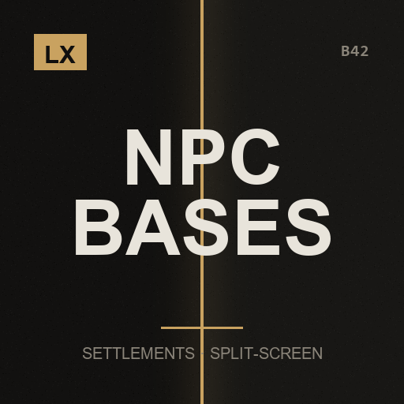

# LX NPC Bases Split-Screen Fix

**Settlement windows on your own half, a gamepad that reaches them, and a map that keeps filling**

> NPC Bases is already careful about multiple players - its loops walk every player and its handlers take a player number. What it never accounts for is two of them sharing one screen.

`Project Zomboid B42.21+` · `v1.0.0` · `CC0`

[English](#english) · [Español](#español) · [Русский](#русский)

---

## English

This mod is part of the **LX Split-Screen Suite**, seven mods that make Project Zomboid B42 playable in 2–4 player couch co-op, with or without a gamepad. Each one stands alone — install only what you need.

### Why split-screen?

Split-screen is the mode that carries the most bugs in stable B42 — and the mods worth playing with, like Bandits and Project A-Life, are built for singleplayer and online multiplayer. Nobody is fixing couch co-op. This suite exists to close that gap: to make split-screen as playable as the modes that get the attention.

### Why gamepad?

B42 keeps improving controller support, but it is still rough, and the aim-and-shoot rework left gunplay on a gamepad close to unusable — you cannot even shoot a zombie lying on the ground. Split-screen *with* a gamepad is the worst case the game offers. These mods give PZ back an aim that was designed for a stick: assist on the vertical axis, B41-style lock-on, per-player aim state, and a lot more.

### What it does

- **Four windows, each on the right half of the screen** — Admin, Clans, Expansion and Defender Weapons were all measured and centred against the WHOLE game window, so in split-screen they straddled the divide or opened on the other player's half entirely. Each now opens inside the viewport of the player who asked for it. The Defender Weapons window turned up only because it shared a line of code with the Expansion one - it had the same bug and would otherwise have been missed.
- **Every window takes a gamepad** — They are ISCollapsableWindow panels full of buttons and lists: with a controller there was simply no way in. The d-pad walks the controls, A presses, B closes. It only engages for a player who actually has a pad assigned, and the window releases that pad the moment it closes or anything goes wrong - a window that keeps the controller would leave you unable to move, which is worse than no navigation at all.
- **Bases keep appearing as you travel** — This is the real reason the map stops feeling alive. NPC Bases counts its MaxBases cap across the WHOLE world: once six stand, no new base is ever founded again, however far you walk - and two players exploring burn that cap at twice the rate. The cap now counts only the bases NEAR you, so local density stays exactly what the author chose while the world behind you keeps its settlements. A world ceiling keeps a long game in check. It costs nothing: NPC Bases already skips any base whose chunk is not loaded.
- **New towns get settled promptly** — Walk into an area with no bases and the original still waits six game hours, then rolls a 35% chance: about seventeen hours on average before it even tries, which reads as the mod being switched off. While no base is near, that check drops to two hours. Every minimum distance the author set still applies, so nothing can appear on top of you.
- **Messages reach a player who is actually there** — The mod's notices went to "the player", which in split-screen is not deterministic and can be someone who is already dead. They now go to the first living local player. The fallback that decides "is this my character" compared against that same call, which quietly excluded player 2 altogether. And on a server, the ten-minute cleanup swept only around player 1, so whatever player 2 left behind stayed there for good.
- **Nothing of NPC Bases is redistributed** — Its files are read from your installed copy at load time, patched in memory and run from there. This mod always sits on top of whatever NPC Bases version you have, and ships none of its author's work. If NPC Bases updates and a snippet no longer matches, that patch is skipped with a note in console.txt and the original code runs unchanged.

### Requirements

| Mod | Workshop | |
|---|---|---|
| NPC Bases | [3796483217](https://steamcommunity.com/sharedfiles/filedetails/?id=3796483217) | required |
| Bandits | [3268487204](https://steamcommunity.com/sharedfiles/filedetails/?id=3268487204) | required |

**Load order:** load this **after** `NPC Bases`, `Bandits`. `mod.info` already declares it.

### Installing

**From the Steam Workshop (recommended)**
Subscribe on the Workshop page. Steam downloads it; then start Project Zomboid, go to
**Mods** in the main menu and enable it. In split-screen, enabling it once covers all players.

**Manually**
1. Download this repository (green **Code** button -> **Download ZIP**) and unzip it.
2. Copy the folder `LX_NPCBasesSplit` into your Zomboid mods folder:
   - Windows: `C:\Users\<you>\Zomboid\mods\`
   - Linux: `~/Zomboid/mods/`
   - macOS: `~/Library/Application Support/Zomboid/mods/`
   The result must be `...\Zomboid\mods\LX_NPCBasesSplit\42\mod.info`.
3. Start the game, open **Mods** in the main menu and enable **LX NPC Bases Split-Screen Fix**.

### Options

Main menu > Options > MODS > "LX NPC Bases Split": turn "bases that follow you" on or off, set what counts as near, the world ceiling, and whether new towns settle faster. The split-screen and gamepad fixes are always on and have nothing to configure.

### Notes

- **Nothing is installed inside NPC Bases' folder.** Each patch is matched against an exact snippet; if NPC Bases updates and a snippet no longer matches, that patch is skipped with a note in `console.txt` and its original code runs unchanged. 13 changes across 4 files, every patched file compiled before shipping.
- A summary of how many changes were applied is printed in `console.txt` at game start. Worth a look the first time you launch.
- **"Bases that follow you" is the only thing here that changes the original's balance**, and it is a setting you can switch off. Everything else is a correction: without it, those windows and messages were simply broken in split-screen. On a dedicated server the base logic is left exactly as the author wrote it.
- Must load **after** NPC Bases, which in turn needs Bandits. `mod.info` already declares it.
- Credit where it is due: NPC Bases is by Shaint and the Bandits NPC engine is by Slayer. Neither is mine, and neither declares a license - which is exactly why nothing of theirs is copied into this mod.

### License

**CC0 1.0 Universal** — public domain dedication. Do whatever you want with it: copy it, change it, put it in a modpack, publish it, sell it. No permission needed, no credit required (though it is always welcome). See `LICENSE`.

### Support

If these mods made your co-op run work, you can buy me a coffee — [ko-fi.com/litoxperaloca](https://ko-fi.com/litoxperaloca)

### The rest of the suite

- [LX Coop Fixes](https://github.com/litoxperaloca/LX_CoopFixes) — Split-screen stability: vehicle crash, player 2 aiming, map stutter, error spam.
- [LX Split Aim](https://github.com/litoxperaloca/LX_SplitAim) — Controller aim assist and B41-style lock-on, per local player.
- [LX Split-Screen Quick Build](https://github.com/litoxperaloca/LX_SPLITSCREEN_CONTEXTMENU_BUILDING) — B41-style build menu in the context menu, because B42's window does not fit.
- [LX A-Life Split-Screen Fix](https://github.com/litoxperaloca/LX_ALifeSplit) — Project A-Life NPCs react to every local player, not just player 1.
- [LX Bandits Split-Screen Fix](https://github.com/litoxperaloca/LX_BanditsSplit) — Bandits target the right player, companions follow who recruited them.
- [LX Split-Screen Welcome Package](https://github.com/litoxperaloca/LX_SPLITSCREEN_WELCOME_PACKAGE) — A configurable starter kit per local character.
- [LX Split-Screen Skills Boost](https://github.com/litoxperaloca/LX_SPLITSCREEN_SKILLS_IMPROVE) — A configurable skill floor per local character.
- [LX Theodore Split-Screen Fix](https://github.com/litoxperaloca/LX_TheodoreSplit) — Theodore, the family NPC, reacts to every local player and works with a gamepad.

---

## Español

> NPC Bases ya es cuidadoso con varios jugadores: sus bucles recorren a todos y sus handlers reciben el numero de jugador. Lo que nunca contempla es que dos compartan una pantalla.

Este mod es parte de la **LX Split-Screen Suite**, siete mods que hacen jugable Project Zomboid B42 en coop de sillón de 2 a 4 jugadores, con o sin mando. Cada uno funciona por separado — instalá solo lo que precises.

### ¿Por qué pantalla dividida?

Es la modalidad con más bugs en la B42 estable — y los mods que valen la pena, como Bandits y Project A-Life, están pensados para un jugador y multijugador online. Nadie arregla el coop de sillón. Esta suite existe para cerrar esa brecha: dejar la pantalla dividida a la par de las modalidades que sí reciben atención.

### ¿Por qué mando?

La B42 viene mejorando el soporte de mando, pero todavía deja mucho que desear, y el rework de apuntado y disparo dejó el tiroteo con mando casi imposible — ni siquiera podés dispararle a un zombi en el suelo. Pantalla dividida *con* mando es el peor escenario posible del juego. Estos mods le devuelven a PZ un apuntado pensado para stick: asistencia en el eje vertical, fijado de blanco estilo B41, estado de apuntado por jugador, y bastante más.

### Qué hace

- **Cuatro ventanas, cada una en la mitad que corresponde** — Administracion, Clanes, Expansion y Armas de defensores se median y se centraban contra la ventana ENTERA del juego, asi que en pantalla dividida quedaban a caballo de la division o directamente se abrian en la mitad del otro jugador. Ahora cada una se abre dentro del viewport del jugador que la pidio. La de Armas de defensores aparecio solo porque compartia una linea de codigo con la de Expansion: tenia el mismo bug y si no se me hubiera pasado.
- **Todas las ventanas andan con mando** — Son paneles ISCollapsableWindow llenos de botones y listas: con un control no habia forma de entrar. La cruceta recorre los controles, A activa, B cierra. Solo se activa para un jugador que realmente tenga un mando asignado, y la ventana suelta ese mando apenas se cierra o si algo falla: una ventana que se queda con el control te deja sin poder moverte, que es peor que no tener navegacion.
- **Las bases siguen apareciendo mientras viajas** — Esta es la razon real de que el mapa deje de sentirse vivo. NPC Bases cuenta su tope MaxBases sobre TODO el mundo: una vez que hay seis, no funda ninguna mas por lejos que camines, y entre dos explorando ese cupo se gasta al doble de velocidad. Ahora el tope cuenta solo las bases que tenes CERCA, asi la densidad local queda exactamente en lo que eligio el autor y el mundo que dejas atras conserva sus asentamientos. Un techo mundial mantiene a raya una partida larga. No cuesta nada: NPC Bases ya se saltea toda base cuyo chunk no este cargado.
- **Los pueblos nuevos se pueblan sin hacerte esperar** — Entras a una zona sin bases y el original igual espera seis horas de juego, y recien ahi tira un 35%: unas diecisiete horas de media antes de siquiera intentarlo, que se lee como que el mod esta apagado. Mientras no haya ninguna base cerca, esa comprobacion baja a dos horas. Todas las distancias minimas que puso el autor se siguen respetando, asi que no te puede aparecer una encima.
- **Los avisos le llegan a un jugador que este ahi** — Los avisos del mod iban a "el jugador", que en pantalla dividida no es deterministico y puede ser alguien que ya esta muerto. Ahora van al primer jugador local vivo. El respaldo que decide "es mi personaje" comparaba contra esa misma llamada, lo que dejaba al jugador 2 afuera sin que se notara. Y en servidor, la limpieza de cada diez minutos barria solo alrededor del jugador 1, asi que lo que dejaba el jugador 2 se quedaba ahi para siempre.
- **No se redistribuye nada de NPC Bases** — Sus archivos se leen de tu copia instalada al cargar, se parchean en memoria y se ejecutan desde ahi. Este mod siempre corre sobre la version de NPC Bases que tengas, y no lleva adentro nada del trabajo de su autor. Si NPC Bases se actualiza y un fragmento deja de coincidir, ese parche se omite con un aviso en console.txt y el codigo original corre sin cambios.

### Requisitos

| Mod | Workshop | |
|---|---|---|
| NPC Bases | [3796483217](https://steamcommunity.com/sharedfiles/filedetails/?id=3796483217) | obligatorio |
| Bandits | [3268487204](https://steamcommunity.com/sharedfiles/filedetails/?id=3268487204) | obligatorio |

**Orden de carga:** cargá este **después** de `NPC Bases`, `Bandits`. El `mod.info` ya lo declara.

### Instalación

**Desde el Steam Workshop (recomendado)**
Suscribite en la página del Workshop. Steam lo descarga solo; después abrí Project Zomboid,
andá a **Mods** en el menú principal y activalo. En pantalla dividida, con activarlo una vez
alcanza para todos los jugadores.

**A mano**
1. Descargá este repositorio (botón verde **Code** -> **Download ZIP**) y descomprimilo.
2. Copiá la carpeta `LX_NPCBasesSplit` a tu carpeta de mods de Zomboid:
   - Windows: `C:\Users\<vos>\Zomboid\mods\`
   - Linux: `~/Zomboid/mods/`
   - macOS: `~/Library/Application Support/Zomboid/mods/`
   Tiene que quedar `...\Zomboid\mods\LX_NPCBasesSplit\42\mod.info`.
3. Abrí el juego, entrá a **Mods** en el menú principal y activá **LX NPC Bases Split-Screen Fix**.

### Opciones

Menu principal > Opciones > MODS > "LX NPC Bases Split": activar o desactivar "bases que te siguen", que cuenta como cerca, el techo del mundo, y si los pueblos nuevos se pueblan mas rapido. Las correcciones de pantalla dividida y mando estan siempre activas y no se configuran.

### Notas

- **No se instala nada dentro de la carpeta de NPC Bases.** Cada parche se compara contra un fragmento exacto; si NPC Bases se actualiza y un fragmento deja de coincidir, ese parche se omite con un aviso en `console.txt` y su codigo original corre sin cambios. 13 cambios en 4 archivos, y cada archivo parcheado se compilo antes de publicarlo.
- Al iniciar la partida se imprime en `console.txt` un resumen de cuantos cambios se aplicaron. Vale la pena mirarlo la primera vez.
- **"Bases que te siguen" es lo unico aca que cambia el equilibrio del original**, y es una opcion que podes apagar. Todo lo demas es correccion: sin eso, esas ventanas y esos avisos estaban rotos en pantalla dividida. En un servidor dedicado la logica de bases queda exactamente como la escribio el autor.
- Debe cargar **despues** de NPC Bases, que a su vez necesita Bandits. El `mod.info` ya lo declara.
- El credito donde corresponde: NPC Bases es de Shaint y el motor de NPCs Bandits es de Slayer. Ninguno es mio, y ninguno declara licencia: por eso mismo no se copia nada de ellos dentro de este mod.

### Licencia

**CC0 1.0 Universal** — dedicado al dominio público. Hacé lo que quieras: copialo, cambialo, metélo en un modpack, publicalo, vendelo. No hace falta permiso ni crédito (aunque siempre se agradece). Ver `LICENSE`.

### Apoyar

Si estos mods te arreglaron el coop, podés invitarme un café — [ko-fi.com/litoxperaloca](https://ko-fi.com/litoxperaloca)

### El resto de la suite

- [LX Coop Fixes](https://github.com/litoxperaloca/LX_CoopFixes) — Estabilidad en pantalla dividida: crash de vehículos, apuntado del jugador 2, tirones del mapa, spam de errores.
- [LX Split Aim](https://github.com/litoxperaloca/LX_SplitAim) — Asistencia de apuntado con mando y fijado de blanco estilo B41, por jugador local.
- [LX Split-Screen Quick Build](https://github.com/litoxperaloca/LX_SPLITSCREEN_CONTEXTMENU_BUILDING) — Menú de construcción estilo B41 en el menú contextual, porque la ventana de B42 no entra.
- [LX A-Life Split-Screen Fix](https://github.com/litoxperaloca/LX_ALifeSplit) — Los NPCs de Project A-Life reaccionan a todos los jugadores locales, no solo al 1.
- [LX Bandits Split-Screen Fix](https://github.com/litoxperaloca/LX_BanditsSplit) — Los bandidos apuntan al jugador correcto, los compañeros siguen a quien los reclutó.
- [LX Split-Screen Welcome Package](https://github.com/litoxperaloca/LX_SPLITSCREEN_WELCOME_PACKAGE) — Un equipo inicial configurable por personaje local.
- [LX Split-Screen Skills Boost](https://github.com/litoxperaloca/LX_SPLITSCREEN_SKILLS_IMPROVE) — Un piso de habilidades configurable por personaje local.
- [LX Theodore Split-Screen Fix](https://github.com/litoxperaloca/LX_TheodoreSplit) — Theodore, el NPC familiar, reacciona a todos los jugadores locales y anda con mando.

---

## Русский

> NPC Bases уже аккуратен с несколькими игроками: его циклы обходят всех, а обработчики получают номер игрока. Он лишь не учитывает, что двое делят один экран.

Этот мод входит в набор **LX Split-Screen Suite** — семь модов, которые делают Project Zomboid B42 играбельным в совместной игре на диване для 2–4 человек, с геймпадом или без. Каждый работает сам по себе — ставьте только нужное.

### Почему разделённый экран?

Разделённый экран — режим с наибольшим числом ошибок в стабильной B42, а моды, ради которых стоит играть, вроде Bandits и Project A-Life, сделаны под одиночную игру и сетевой мультиплеер. Совместной игрой на диване не занимается никто. Этот набор существует, чтобы закрыть пробел: сделать разделённый экран таким же играбельным, как режимы, которым достаётся внимание.

### Почему геймпад?

B42 продолжает улучшать поддержку контроллеров, но она всё ещё сырая, а переработка прицеливания и стрельбы сделала перестрелки с геймпада почти невозможными — вы даже не можете выстрелить в зомби, лежащего на полу. Разделённый экран *вместе* с геймпадом — худший случай, который предлагает игра. Эти моды возвращают PZ прицеливание, рассчитанное на стик: помощь по вертикальной оси, захват цели в стиле B41, отдельное состояние прицеливания для каждого игрока и многое другое.

### Что делает

- **Четыре окна, каждое на нужной половине экрана** — Окна администрирования, кланов, экспансии и оружия защитников измерялись и центровались относительно ВСЕГО окна игры, поэтому на разделённом экране они попадали на линию раздела или целиком открывались на половине другого игрока. Теперь каждое открывается в области того игрока, который его вызвал. Окно оружия защитников нашлось лишь потому, что делило строку кода с окном экспансии.
- **Все окна работают с геймпадом** — Это панели ISCollapsableWindow с кнопками и списками: с контроллером в них было не попасть. Крестовина перемещается по элементам, A нажимает, B закрывает. Включается только для игрока с назначенным геймпадом, и окно отпускает его сразу при закрытии или при любой ошибке: окно, удерживающее геймпад, оставит вас без управления.
- **Базы продолжают появляться по мере путешествия** — Именно поэтому карта перестаёт казаться живой. NPC Bases считает лимит MaxBases по ВСЕМУ миру: как только их шесть, новые не появятся никогда, как бы далеко вы ни ушли, а вдвоём этот лимит расходуется вдвое быстрее. Теперь лимит считает только базы РЯДОМ с вами: местная плотность остаётся той, что выбрал автор, а мир позади сохраняет свои поселения. Это ничего не стоит: NPC Bases уже пропускает базы с незагруженным чанком.
- **Новые города заселяются без долгого ожидания** — Придя в район без баз, оригинал всё равно ждёт шесть игровых часов и лишь затем бросает 35%: в среднем около семнадцати часов до первой попытки, и кажется, что мод выключен. Пока рядом нет ни одной базы, проверка снижается до двух часов. Все минимальные дистанции автора соблюдаются.
- **Сообщения доходят до игрока, который действительно рядом** — Уведомления мода шли «игроку», что на разделённом экране недетерминировано и может оказаться уже погибшим персонажем. Теперь они идут первому живому локальному игроку. Проверка «это мой персонаж» сравнивалась с тем же вызовом и незаметно исключала второго игрока.
- **Ничего из NPC Bases не распространяется** — Его файлы читаются из вашей копии при загрузке, патчатся в памяти и запускаются оттуда. Если мод обновится и фрагмент перестанет совпадать, патч пропускается с записью в console.txt, а оригинальный код работает без изменений.

### Требования

| Mod | Workshop | |
|---|---|---|
| NPC Bases | [3796483217](https://steamcommunity.com/sharedfiles/filedetails/?id=3796483217) | обязательно |
| Bandits | [3268487204](https://steamcommunity.com/sharedfiles/filedetails/?id=3268487204) | обязательно |

**Порядок загрузки:** загружайте этот мод **после** `NPC Bases`, `Bandits`. `mod.info` уже это объявляет.

### Установка

**Из Steam Workshop (рекомендуется)**
Подпишитесь на странице Workshop. Steam скачает мод сам; затем запустите Project Zomboid,
откройте **Моды** в главном меню и включите его. При разделённом экране достаточно включить
один раз — это работает для всех игроков.

**Вручную**
1. Скачайте этот репозиторий (зелёная кнопка **Code** -> **Download ZIP**) и распакуйте.
2. Скопируйте папку `LX_NPCBasesSplit` в папку модов Zomboid:
   - Windows: `C:\Users\<вы>\Zomboid\mods\`
   - Linux: `~/Zomboid/mods/`
   - macOS: `~/Library/Application Support/Zomboid/mods/`
   Должно получиться `...\Zomboid\mods\LX_NPCBasesSplit\42\mod.info`.
3. Запустите игру, откройте **Моды** в главном меню и включите **LX NPC Bases Split-Screen Fix**.

### Настройки

Главное меню > Настройки > МОДЫ > «LX NPC Bases Split»: включить или выключить «базы, которые следуют за вами», задать радиус, предел мира и ускоренное заселение новых городов. Исправления разделённого экрана и геймпада всегда активны.

### Примечания

- **Внутрь папки NPC Bases ничего не устанавливается.** Если мод обновится и фрагмент перестанет совпадать, этот патч пропускается. 13 изменений в 4 файлах, каждый файл скомпилирован перед публикацией.
- При запуске игры в `console.txt` выводится сводка применённых изменений.
- **«Базы, которые следуют за вами» — единственное здесь, что меняет баланс оригинала**, и это настройка, которую можно выключить. Всё остальное — исправления. На выделенном сервере логика баз остаётся ровно такой, какой её написал автор.
- Загружать **после** NPC Bases, которому, в свою очередь, нужен Bandits.
- NPC Bases — мод Shaint, движок NPC Bandits — Slayer. Ни один не мой и ни один не объявляет лицензию: именно поэтому ничего из их работы не копируется в этот мод.

### Лицензия

**CC0 1.0 Universal** — передано в общественное достояние. Делайте что угодно: копируйте, изменяйте, включайте в сборки модов, публикуйте, продавайте. Разрешение не требуется, указание авторства не обязательно (но всегда приятно). См. `LICENSE`.

### Поддержать

Если эти моды помогли вашей совместной игре, можете угостить меня кофе — [ko-fi.com/litoxperaloca](https://ko-fi.com/litoxperaloca)

### Остальные моды набора

- [LX Coop Fixes](https://github.com/litoxperaloca/LX_CoopFixes) — Стабильность разделённого экрана: вылет транспорта, прицеливание второго игрока, подтормаживания карты.
- [LX Split Aim](https://github.com/litoxperaloca/LX_SplitAim) — Помощь прицеливания с геймпада и захват цели в стиле B41 для каждого локального игрока.
- [LX Split-Screen Quick Build](https://github.com/litoxperaloca/LX_SPLITSCREEN_CONTEXTMENU_BUILDING) — Меню строительства в стиле B41 в контекстном меню, потому что окно B42 не помещается.
- [LX A-Life Split-Screen Fix](https://github.com/litoxperaloca/LX_ALifeSplit) — NPC из Project A-Life реагируют на всех локальных игроков, а не только на первого.
- [LX Bandits Split-Screen Fix](https://github.com/litoxperaloca/LX_BanditsSplit) — Бандиты целятся в нужного игрока, напарники следуют за тем, кто их нанял.
- [LX Split-Screen Welcome Package](https://github.com/litoxperaloca/LX_SPLITSCREEN_WELCOME_PACKAGE) — Настраиваемый стартовый набор для каждого локального персонажа.
- [LX Split-Screen Skills Boost](https://github.com/litoxperaloca/LX_SPLITSCREEN_SKILLS_IMPROVE) — Настраиваемый минимальный уровень навыков для каждого локального персонажа.
- [LX Theodore Split-Screen Fix](https://github.com/litoxperaloca/LX_TheodoreSplit) — Theodore реагирует на всех локальных игроков и работает с геймпадом.

